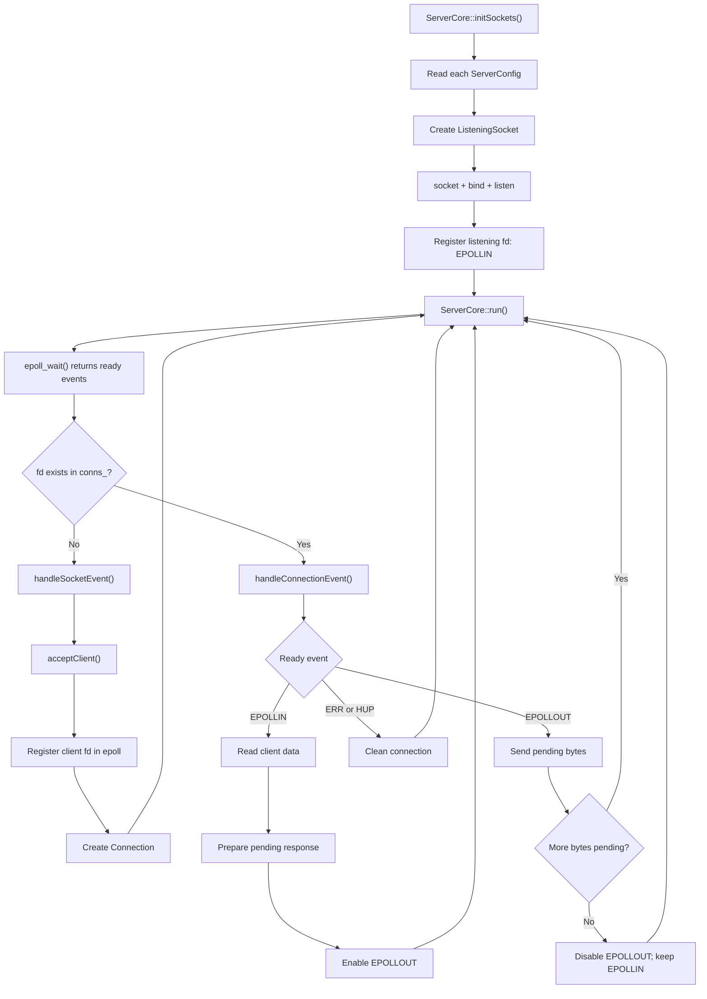

# ServerCore Event Flow

## Overview

`ServerCore` coordinates the listening sockets, the connected clients, and the
`epoll` instance used by the server.

Its work can be divided into four main stages:

1. `initSockets()` creates one listening socket for each server
   configuration and registers it in `epoll` with `EPOLLIN`.
2. The main loop calls `epoll_wait()` to obtain the descriptors that are ready.
3. `handleSocketEvent()` accepts new clients when a listening socket becomes
   readable.
4. `handleConnectionEvent()` reads requests from connected clients and sends
   pending data when their sockets are ready.

> **Note:** The code fragments below are simplified examples based on the
> described control flow. They show the responsibility of each method without
> reproducing unrelated logging, parsing, or error-handling details from the
> complete implementation.

The server distinguishes listening sockets from connected clients through the
`conns_` map:

```cpp
if (conns_.count(cur_fd))
    handleConnectionEvent(events[i]);
else
    handleSocketEvent(cur_fd);
```

If `cur_fd` exists in `conns_`, it belongs to an accepted client. Otherwise,
`ServerCore` treats it as a listening socket and searches for it in `socks_`.

## 1. `initSockets()`

### Purpose

`initSockets()` prepares the server to receive connections. It iterates over
the `ServerConfig` vector and creates a `ListeningSocket` for every configured
host and port.

For each configuration, the method:

1. Reads the configured host and listening port.
2. Creates a `ListeningSocket`.
3. Calls `setup()`, which performs `socket()`, `bind()`, and `listen()`.
4. Stores the listening socket in `socks_`.
5. Registers its descriptor in the `epoll` interest list.

The listening descriptor is registered with `EPOLLIN` because, for a listening
socket, readability means that at least one connection is waiting to be
accepted.

### Code

```cpp
void ServerCore::initSockets()
{
    std::vector<ServerConfig>::iterator it;
    ListeningSocket                   *ls;
    struct epoll_event                 event;

    it = configs_.begin();
    while (it != configs_.end())
    {
        ls = new ListeningSocket(it->getHost(), it->getListen());
        ls->setup();
        if (!ls->isReady())
        {
            delete ls;
            ++it;
            continue;
        }
        event.events = EPOLLIN;
        event.data.fd = ls->getFd();
        if (epoll_ctl(epoll_fd_, EPOLL_CTL_ADD,
                event.data.fd, &event) < 0)
        {
            delete ls;
            ++it;
            continue;
        }
        socks_.push_back(ls);
        ++it;
    }
}
```

After this method finishes, every successfully initialized listening socket is
stored by `ServerCore` and monitored by the kernel through the `epoll`
instance.

## 2. Main event loop

### Purpose

The main loop waits for activity without continuously checking every socket.
`epoll_wait()` fills the `events` array with descriptors that are ready at that
moment.

For every returned descriptor, the loop asks one fundamental question:

```cpp
conns_.count(cur_fd)
```

- A non-zero result means that the descriptor belongs to an accepted client.
- A zero result means that it is expected to belong to a listening socket.

The loop therefore dispatches the event to the appropriate handler.

### Code

```cpp
void ServerCore::run()
{
    struct epoll_event events[EVENTS_MAX];
    int                event_count;
    int                cur_fd;
    int                i;

    while (true)
    {
        event_count = epoll_wait(epoll_fd_, events,
                EVENTS_MAX, TIMEOUT_MS);
        if (event_count < 0)
            continue;
        i = 0;
        while (i < event_count)
        {
            cur_fd = events[i].data.fd;
            if (conns_.count(cur_fd))
                handleConnectionEvent(events[i]);
            else
                handleSocketEvent(cur_fd);
            ++i;
        }
    }
}
```

`epoll_wait()` does not return every registered descriptor. It returns only the
registered descriptors that currently have a ready event, together with
automatic conditions such as errors or hang-ups.

## 3. `handleSocketEvent()`

### Purpose

`handleSocketEvent()` processes activity on a listening socket. It searches
`socks_` for the object whose descriptor matches the descriptor returned by
`epoll_wait()`.

When it finds the matching listening socket, the method:

1. Calls `acceptClient()` to accept the pending connection.
2. Obtains a new connected descriptor from `accept()`.
3. Registers the new descriptor in `epoll`.
4. Creates a `Connection` object and stores it in `conns_`.
5. If initial data was added to the connection's write buffer, enables
   `EPOLLOUT` so it can be sent later.

The listening socket remains in `socks_` and continues waiting for other
clients. The new descriptor represents only the accepted connection.

### Code

```cpp
void ServerCore::handleSocketEvent(int fd)
{
    std::vector<ListeningSocket *>::iterator it;
    struct epoll_event                       event;
    int                                      conn_fd;

    it = socks_.begin();
    while (it != socks_.end())
    {
        if ((*it)->getFd() == fd)
        {
            conn_fd = (*it)->acceptClient();
            if (conn_fd < 0)
                return;
            event.events = EPOLLIN;
            event.data.fd = conn_fd;
            if (epoll_ctl(epoll_fd_, EPOLL_CTL_ADD,
                    conn_fd, &event) < 0)
            {
                close(conn_fd);
                return;
            }
            conns_[conn_fd] = new Connection(conn_fd);
            return;
        }
        ++it;
    }
}
```

If the connection already contains pending output, its interest can be changed
from `EPOLLIN` to `EPOLLIN | EPOLLOUT` with `EPOLL_CTL_MOD`:

```cpp
event.events = EPOLLIN | EPOLLOUT;
event.data.fd = conn_fd;
epoll_ctl(epoll_fd_, EPOLL_CTL_MOD, conn_fd, &event);
```

This modification does not mean that the class buffer is monitored by
`epoll`. It means that the server wants to know when the connected socket can
accept data through `send()`.

## 4. `handleConnectionEvent()`

### Purpose

`handleConnectionEvent()` processes events for descriptors stored in
`conns_`. These descriptors represent clients that have already been accepted.

The event mask determines the required operation:

- `EPOLLIN` activates the reading path. The server calls `recv()` through the
  `Connection` object and appends the received bytes to its read buffer.
- `EPOLLOUT` activates the writing path. The server calls `send()` through the
  `Connection` object and advances the write offset.
- `EPOLLERR` or `EPOLLHUP` causes the connection to be cleaned up.

After reading a complete request and preparing a response, the method enables
`EPOLLOUT` by changing the interest mask to `EPOLLIN | EPOLLOUT`.

After all pending bytes have been sent, it disables `EPOLLOUT` and returns the
interest mask to `EPOLLIN`. This is important because connected sockets are
usually writable most of the time; monitoring `EPOLLOUT` permanently could
make `epoll_wait()` return repeatedly even when the server has nothing to send.

### Code

```cpp
void ServerCore::handleConnectionEvent(struct epoll_event event)
{
    int fd;

    fd = event.data.fd;
    if (event.events & (EPOLLERR | EPOLLHUP))
    {
        cleanConnection(fd);
        return;
    }
    if (event.events & EPOLLIN)
    {
        if (conns_[fd]->readFromFd() <= 0)
        {
            cleanConnection(fd);
            return;
        }
        /* Parse the request and append the response to write_buff_. */
        if (conns_[fd]->wantsWrite())
            updateEvents(fd, EPOLLIN | EPOLLOUT);
    }
    if (event.events & EPOLLOUT)
    {
        conns_[fd]->writeToFd();
        if (!conns_[fd]->wantsWrite())
            updateEvents(fd, EPOLLIN);
    }
}
```

The exact parsing and response-building code belongs between the read operation
and the activation of `EPOLLOUT`. The important responsibility of
`handleConnectionEvent()` is to connect the ready events reported by the kernel
with the appropriate `Connection` operations.

## Complete flow



## Final responsibility summary

| Component | Main responsibility | Event interest |
| --- | --- | --- |
| `initSockets()` | Create and register listening sockets | Adds `EPOLLIN` |
| Main loop | Wait for ready descriptors and dispatch them | Reads returned events |
| `handleSocketEvent()` | Accept and register new clients | Adds client `EPOLLIN`; may enable `EPOLLOUT` |
| `handleConnectionEvent()` | Read requests, send pending data, and clean connections | Enables or disables `EPOLLOUT` while keeping `EPOLLIN` |

The complete design is event-driven: `ServerCore` does not continuously poll
every socket itself. It tells the kernel which conditions are interesting, and
the kernel returns only the descriptors that are ready for work.
